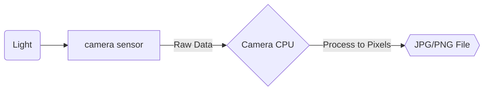
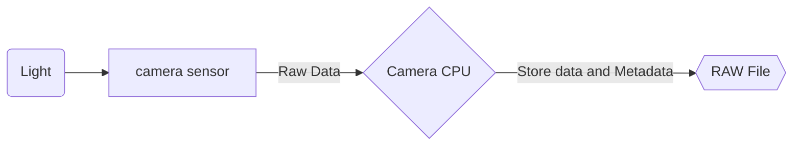

Software has changed. It's been 4 months since I [first wrote](fables-of-fable/) about messing around with AI. Over the last two years it has completely dominated our industry and flipped conventional wisdom on it's head. One major way that it's done this is by making **projects of attrition** much more approachable.

## What is a Project of Attrition

Attrition in this context is being used to convey the sort of project that is a pure matter of will. Creating a "web server" that can just serve HTML pages is a 20 minute task, creating a "web server" that supports **all** of http 1.1 is (or was) a month-long task. These sort of projects done by hand are largely a matter of just the number of hours you put in. A real example might be useful here.

### Artcraft

[ArtCraft](https://getartcraft.com/) is a project that is looking to reimplement a dozen (or more now) industry tools using AI. These products have largely remained because the difficulty in creating them via traditional methods would take years, and the cooperation of many companies for all the different formats. For example [lightcraft](https://getartcraft.com/apps/lightcraft) a project meant to take on adobe lightroom/Camera Raw. A system for processing camera raws.

<sumamry>What is a camera raw

For those that don't do photography a camera raw is a special type of photo. When you shoot with modern cameras you have the option to either take those photos as raster images (JPEG/PNG), or raws (dng, RAW, RW2, ORF, etc.). Your camera takes photos by exposing [photosites](https://pixelcraft.photo.blog/2023/08/01/what-is-a-photosite/) to light. You set various settings ( aperture, shutter speed, and ISO), to control how much light is added to the sensors, and then a "photo" is the result of what those photosites "see".

A raster image (the type most people are familiar with) is a bunch of pixels. The camera takes readings from the sensor, and uses it to generate pixels that make up the image. This is great because it can be compressed easily, and can convey a fair bit of detail, but it's manipulability is limited. If you shot your photo a bit dark, lightening that image means your limited by the resolution of the image taken, and it's bit-depth. This means most edits will leave you with a mess of a photo when editing significantly. 

Raw files on the other hand are a binary format that contains sensor data. Raws basically just bundle the camera sensor data directly as a file format (often a variant of [DNG](https://en.wikipedia.org/wiki/Digital_Negative) or [TIFF-like](https://en.wikipedia.org/wiki/TIFF)). They will contain information like what the readings of a photosite where, the camera settings, the lens used, etc. Everything you need to understand what happened when the shot was taken. You then process raw files to get your final exported raster image. 

Every manufacturer uses their own special version of a raw file. All of them are proprietary, and while projects have existed that support many variants, Adobe is the most reliable option to process any format you throw at it. They work directly with manufacturers, and have an unbelievable amount of data to allow them to be able to process whatever raws you want well. 

Before AI adding support for reading and processing the raws ([Black-level subraction](https://www.e-consystems.com/blog/camera/technology/black-level-correction-in-image-sensors-what-it-is-and-why-it-matters/), [demosaicing](https://en.wikipedia.org/wiki/Demosaicing), etc.) would be arduous. Each format might take you a month if you're doing it from scratch, not to mention needing the skills to be able to do everything necessary in the first place. AI on the other hand can spend thousands of human-equivalent hours banging it's head against the wall, and in parallel. Originally when I first tried lightcraft it had no support for ORF's and ORI's (olympus/OM-system raws). It took less than a week for them to support it. 

### Emulation

Emulation is another fantastic example of a time-intensive problem that takes a long time to solve. If you want to run a nintendo switch game on PC, you need to spend time understanding how a switch works, how it runs games, what encryption is available, etc. For the switch 1 this took years. Up until recently there was basically no progress on switch 2 emulation, and in the span of months there are now running emulators for the system. 

## What this means

Commercially this creates a major problem. Companies like Adobe live off the fact that what they do takes years. That is their "moat". It's what differentiates them, and gives you a reason to pay them. However, they have increasingly been (in my opinion) squeezing their customers since they had no other option (dramatic, other options have existed, but have been less popular). Which means the people they've annoyed with cost increases, cancellation fees, and (arguably) little innovation, can, and will jump ship. It's unlikely that most business-class users will switch for a while since they tend to need more reliability, but the writing is on the wall for these kinds of businesses and their **current model**.

## Advocatus Diaboli

That being said, this is not a universally "good" thing. Projects like these don't come from no-where. Adobe's ability to make their business profitable has kept thousands of people employed, and allowed millions of people to make their creative dreams a reality. The argument that they "deserve" to crash and burn is debateable, even if I (and many others) have personal gripes with it. The baby goes with the bathwater, and in this case the baby is the careers of the incredible engineers and designers that did the attrition in the first place to make software like lightroom possible. Both the existing careers, and the future investment in the next generation have a high likelihood of going up in smoke. 

And that is one of the major dissapointments of this movement. The code having been written by AI means that **no real knowledge** has been gained. None of these projects will innovate in the same way adobe has innovated the industry. The mimicry is handy for now, but the community of these sorts of projects are largely held up by people who:

1. **Couldn't** write the code for the most part
2. **Don't care** because they haven't had to suffer to learn the details
3. Will **move on** if it becomes commercialized

This means that the next generation of attrition software will be much cheaper (or free), but lay no foundations for what comes next. Not to mention...

## Reliability

Adobe fixes bugs, not always immediately, but they do fix them. More importantly we know from experience they have engineers that **can** fix bugs, and create new systems. Everything that's been done in these projects of attrition has worked so far, but what happens when they hit a wall that requires understanding? What happens when the emulator needs a fundamentally different approach to improve it's performance, and the people working on it don't know how anything works? What happens if you're a company that switches to a lightroom alternative that doesn't support your camera, and it has a new approach to it's file format that AI can't figure out? 

There is no track record for these projects, and you (and the creators) don't **know** what lurks beneath the surface. The code is produced far too fast for any human to be able to. Do you really want to put your career on the line banking on ChatGPT or Claude? Not to mention the people and them holding their attention. 

Adobe for better or worse has made photoshop and everything else for decades. We know they're not going to get bored and try to become a crypto millionare next week, leaving their software to rot. Many of the people involved do not have nearly that kind of track record. Many of the vibe coders in the emulation community have literally never written a single line of code ever. This also means cultural norms are not observed either.

### Fracturing

Going off and maintaining your own "fork" of a peice of software has historically been how a bunch of projects died. Someone gets mad, tells the team they're going to go off and do their own thing, and then give up in a month. This fracturing is happening at break-neck pace in these vibe-coding communities. Switch 2 emulation already has Lichii and Egaltine as two separate forks of eden emulator, with many more on the way, and countless forks of each of them. The people involved don't know what maintenance burden looks like, and are unlikely to keep up with it when those realities set in. 

Many of the best projects that have been made came out of tons of community contributions from different people with different backgrounds. Going forward it will likely be the default settings of a collection of frontier models making all the decisions with no "taste" to bring it all together. Not to mention spreading around the potential legal problems...

## Retaliation

Companies do not intend to take these things lying down. Nintendo will go after switch emulators and ROM companies. I'm sure adobe will harass some of the more popular lightroom clones if they truly start eating into their market share in a meaningful way. These "normal" retaliations are expected, but this capability presents an existential risk for a huge chunk of the economy, and everyone will implement their own "protections".

### Death of Ownership

I would expect going forward that 0 physical media will exist for many game companies. The risk of being ripped and having a working emulator is too high. Grand Theft Auto 6, the largest media release ever is already playable in emulators, days after it's release. This will make the ownership of software and hardware significantly worse. I expect that more and more companies will make "streaming" an application the default, with no option to have anything run locally. I expect that more of this control will be exerted, and in more heavy-handed ways across industries.

## Attrition Inversion

Even without the commercial incentive, many projects are now considering closing their source, or becoming just source-available with no outside contributions. Ironically while AI has made these sort of attrition tasks simpler to handle, it has also turned software maintainership into a matter of attrition. Thousands of pull requests on massive repositories, github going down due to load, etc. There's just **so much code** now.

## Fin

Attrition based software was an ambivalent topic for me. It was a testement often to the excellence and persistance of those involved, whereas now it's a monument to the opposite. Many of these projects are slopped-together, low-understanding mimickry of great projects, but maybe that has it's own appeal. I am not a professional photographer, and having a free option to edit photos after buying thousands of dollars of hardware seems like progress of a kind. Democratization can be great, but isn't a universal good, and the nuances of how things **actually** play out will be interesting to see.
